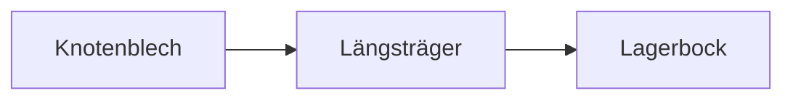

# Rahmenkonstruktion für einen Prüfstand

Diese Datei ist ein Test-Fixture für den Reflow-Modus. Sie ist so geschrieben, wie
Werkzeuge Markdown typischerweise ablegen: Fließtext wird bei etwa Spalte 88 mit
echten Zeilenumbrüchen umbrochen, Tabellen stehen dagegen in einer einzigen langen
Quellzeile. Im Editor bleibt der Absatz deshalb schmal, während die Tabelle die volle
Fensterbreite nutzt.

## 1. Ausgangslage

Die Überarbeitung betrifft drei Baugruppen, die sich in Toleranzkette, Fertigung und
Prüfaufwand deutlich unterscheiden. Für jede Baugruppe wurde zunächst der Ist-Zustand
erhoben und anschließend gegen die Anforderungen aus dem Lastenheft gespiegelt.
Abweichungen wurden nach Schwere gewichtet; die Gewichtung folgt der FMEA-Logik.[^1]

The same holds for the English summary that was added for the external reviewers. It
was exported from a word processor and wrapped at the same column, so every sentence
that crosses the margin carries a hard newline that the reader never intended to see.

| Nr. | Parameter | Ausprägung A | Ausprägung B | Bemerkung |
|---|:---:|---|---|---|
| 1 | Werkstoff | `S235` | `42CrMo4` | Festigkeit gegen Kosten abwägen |
| 2 | Fügeverfahren | Schweißen | Schrauben `M8\|M10` | lösbar bevorzugt |
| 3 | Oberfläche | verzinkt | pulverbeschichtet | Korrosionsklasse C3 |

Unter der Tabelle steht direkt ein weiterer Absatz, der ebenfalls hart umbrochen ist
und dessen erste Zeile die Tabelle nicht berühren darf, weil sonst das Overlay
verschoben würde.

### 1.1 Bewertungsschema

Ein Absatz mit explizitem Zeilenumbruch am Ende dieser Zeile  
und einer Folgezeile, die trotzdem getrennt bleiben muss.

Ein Absatz mit Backslash-Umbruch\
und einer zweiten Zeile, die ebenfalls getrennt bleibt.

Setext-Überschrift zweiter Ebene
--------------------------------

Nach der Setext-Überschrift folgt Fließtext, der über mehrere Zeilen geht und im
Reflow-Modus zu einer einzigen visuellen Zeile zusammengezogen werden darf, solange
das Fenster breit genug ist.

## 2. Varianten

1. Variante A setzt auf einen geschweißten Rahmen, der günstig in der Herstellung ist,
   aber nach dem Verzinken nachgerichtet werden muss.
2. Variante B verwendet einen geschraubten Rahmen:

   ```json
   { "bauteil": "Rahmen",
     "verbindung": "M8" }
   ```

3. Variante C kombiniert beide Ansätze.
Fußnote zur Liste, die nicht in den letzten Punkt gezogen werden darf.

- Erster Punkt einer ungeordneten Liste
  mit einer eingerückten Fortsetzungszeile
- Zweiter Punkt
  - Verschachtelter Punkt

> Zitat aus dem Review-Protokoll, das ebenfalls über mehrere Zeilen
> umbrochen wurde und im Reflow-Modus zusammenfließen soll.
>> Eine verschachtelte Antwort auf das Zitat.

## 3. Herleitung

Die Steifigkeit des Rahmens ergibt sich aus der Summe der Einzelsteifigkeiten. Für die
Abschätzung genügt das lineare Modell:

$$
k_{ges} = \sum_{i=1}^{n} k_i
$$


Die Skizze zeigt den Kraftfluss. Er läuft über die Knotenbleche in die Längsträger und
von dort in die Lagerböcke, die ihrerseits auf dem Fundament verschraubt sind.



```swift
let toleranz = 0.05
let kette = [0.01, 0.02, 0.02]
```

    eingerückter Code bleibt
    ebenfalls Zeile für Zeile stehen

<details>
<summary>Rohdaten der Messung</summary>
Messreihe 1: 12,1 / 12,3 / 12,2
</details>

---

[^1]: Die Gewichtung folgt der Norm für Fehlermöglichkeits- und Einflussanalyse und
wurde im Projektteam abgestimmt.

[norm]: https://example.org/fmea

## 4. Offene Punkte

Der Abschnitt schließt mit einer Checkliste. Dokumente, die mit einer Liste enden,
haben den Reflow früher stillschweigend abgeschaltet, weil der Klassifikator den
Listenzustand am Dokumentende statt an der jeweiligen Zeile gelesen hat.

- [ ] Toleranzkette für Variante B nachrechnen
- [x] Lastenheft gegen Variante A prüfen
- [ ] Angebot für Pulverbeschichtung einholen
